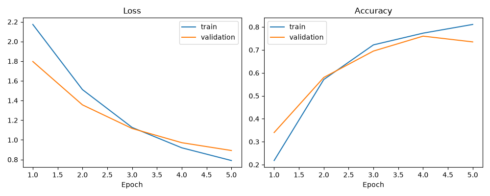
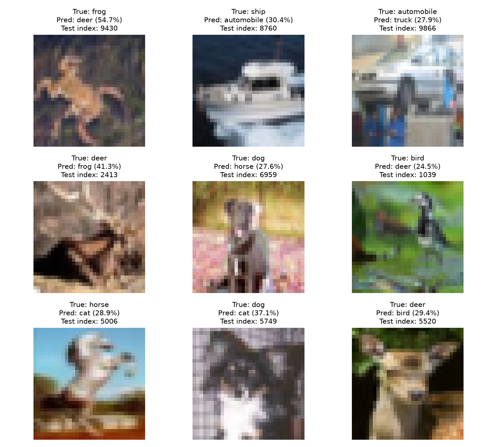
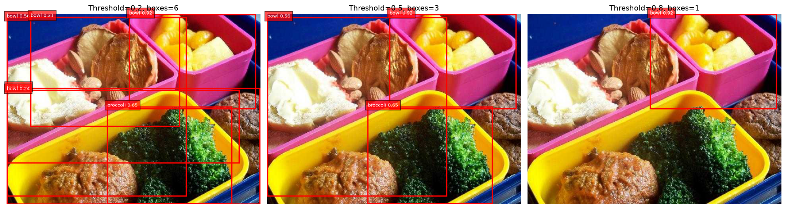
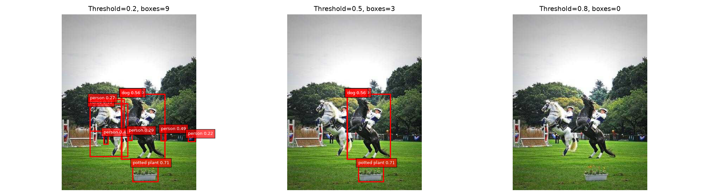

# Lab02 实验指导手册（教师版）

## 迁移学习与目标检测：ResNet18 图像分类、YOLOv8n 检测与结果分析

适用课程：《深度学习与应用》；适用对象：已掌握 CNN、反向传播和 PyTorch 基本训练流程的学生。配套目录：`lab02_cv/`。

本手册依据当前 `lab.py`、`detection.py` 和 `README.md` 编写，供教师备课、投屏讲解、上机巡视与实验评价使用。建议分两次课、每次 4 学时开展；学时安排和评分均为教学建议，可按课程要求调整。

手册中的示例图表来自编写时仓库已有输出，不代表本次重新训练或重新检测的结果，也不是学生必须达到的指标。独立副本保存在 `docs/assets/reference_run/`，学生报告应填写自己的实际运行结果。

### 阅读导航

| 教师需要做什么 | 阅读位置 |
|---|---|
| 快速掌握实验任务和讲解主线 | 第 1 节 |
| 安排两次课、确定课堂检查点 | 第 2 节 |
| 检查环境、数据和离线材料 | 第 3 节 |
| 讲迁移学习并逐段解释代码 | 第 4—5 节 |
| 用真实曲线和误分类组织讨论 | 第 6 节 |
| 讲检测、阈值、NMS 和推理代码 | 第 7—8 节 |
| 布置对照实验、课堂提问、处理报错 | 第 9—11 节 |
| 布置报告与评分、准备收课板书 | 第 12—13 节 |

## 1. 教师速览：本实验究竟让学生学会什么

### 1.1 两条实验主线

| 维度 | 任务 A：迁移学习分类 | 任务 B：预训练模型检测 |
|---|---|---|
| 入口 | `lab.py` | `detection.py` |
| 输入 | CIFAR-10 图像及类别标签 | 5—10 张场景图片 |
| 预训练模型 | ImageNet 预训练 ResNet18 | COCO 预训练 YOLOv8n |
| 是否训练 | 训练新建的全连接分类层 | 仅推理，不训练 |
| 输出 | 每张图的 10 类 logits | 每张图数量可变的框、类别和分数 |
| 核心操作 | 冻结主干、替换分类层、按验证集选模 | 固定预测结果，比较置信度阈值 |
| 评价证据 | 训练/验证曲线、最终测试 Accuracy、真实错误 | 阈值对比图、框数表、可见误检与漏检 |

可直接对学生说：

> 上次实验学习怎样训练一个卷积网络。这次先利用别人已经学到的图像特征，只训练适合新任务的分类层；再使用一个现成检测器，观察它在真实图片上怎样给出位置、类别和分数。两项任务都要解释结果，不能只证明程序运行过。

### 1.2 课堂结束时应能观察到的能力

1. 能指出分类模型中哪些参数更新、哪些参数保持不变，并解释为什么还要固定 BatchNorm 的运行统计量。
2. 能写出分类输入、特征、logits 和标签的形状，说明交叉熵为何直接接收 logits。
3. 能区分训练集、验证集和测试集，解释为什么加载最佳验证模型而非直接使用最后一轮。
4. 能读懂检测框的坐标、类别和分数，区分置信度阈值与 NMS IoU 阈值。
5. 能用实际曲线、图片和 CSV 支持结论，并说明本实验评价的范围。

### 1.3 授课时持续追问的四句话

- “现在改变的是模型参数、模块运行模式，还是显示结果的筛选条件？”
- “这个判断使用的是训练集、验证集，还是测试集？”
- “你说模型更好，具体依据是哪张图、哪一列数据？”
- “这项结论是在当前图片和设置下成立，还是有足够证据推广到其他场景？”

## 2. 建议教学安排与课堂检查点

以下按每学时 45 分钟举例，合计 8 学时、360 分钟，不含课间休息。若课时紧张，可将环境检查前置到课前，保留基础运行和结果分析，将扩展改为选做。

### 2.1 第一次课：迁移学习分类（4 学时）

| 学时 | 时间分配示例 | 教师讲解与演示 | 学生活动与完成标志 |
|---|---|---|---|
| 1 | 导入 10 分钟；原理 15 分钟；检查 20 分钟 | 对比从头训练、冻结主干和微调；检查解释器、GPU、数据、权重 | 能找到入口与参数区；确认本地数据可用 |
| 2 | 数据 20 分钟；模型 20 分钟；提问 5 分钟 | 解释数据划分、预处理、张量形状、冻结与替换顺序 | 画出 `[N,3,224,224] → [N,512] → [N,10]`，算出 5130 个可训练参数 |
| 3 | 训练流程 15 分钟；运行与巡视 30 分钟 | 解释 `run_epoch`、梯度开关、按验证 Accuracy 保存模型 | 跑通默认训练；保留参数、日志与输出 |
| 4 | 曲线 15 分钟；错误分析 15 分钟；汇报 15 分钟 | 用第 6 节示例区分最佳轮次与最后轮次 | 说明自己的最佳验证轮次；分析至少 2 个真实错误 |

### 2.2 第二次课：YOLO 检测与对照分析（4 学时）

| 学时 | 时间分配示例 | 教师讲解与演示 | 学生活动与完成标志 |
|---|---|---|---|
| 1 | 复习 5 分钟；原理 25 分钟；读图 15 分钟 | 分类与检测的差异；框、分数、IoU、NMS | 能手算一个 IoU，说明两个阈值作用不同 |
| 2 | 代码 20 分钟；运行与检查 25 分钟 | 读图、加载权重、逐图预热、有效推理、筛选和绘图 | 用 5—10 张图片跑通程序，找到对比图与 CSV |
| 3 | 讨论 15 分钟；实践 30 分钟 | 固定变量、检测失败案例；按时间安排选做扩展 | 完成至少 3 张图片的分析；有余力时做一项扩展 |
| 4 | 汇报 20 分钟；报告 15 分钟；收课 10 分钟 | 核对证据、结果边界与报告要求 | 能说明一个误检、一个漏检以及阈值的取舍 |

### 2.3 四个适合巡视时现场提问的检查点

| 检查点 | 学生现场展示 | 教师快速判断 |
|---|---|---|
| A：模型搭建 | 冻结循环、替换 `fc`、优化器 | 只有新 `fc` 参与优化；没有把新层一起冻结 |
| B：训练完成 | `history.csv`、`best.pt`、`test_result.txt` | 最佳模型按验证列选择；能够追溯对应轮次 |
| C：检测完成 | 同图三个阈值面板及 CSV 对应三行 | 能解释框数变化与共享耗时 |
| D：结果解释 | 一条真实失败案例 | 区分观察事实和可能原因，不把猜测当作证明 |

## 3. 课前准备与运行方式

### 3.1 教师课前材料清单

- 确认能运行的 Python 解释器；当前工作区配置指向 `/opt/conda/bin/python`。
- 准备 CIFAR-10 官方 Python 版压缩包或完整解压目录。
- 准备 ResNet18 与 YOLOv8n 权重，或提前验证首次下载可用。
- 准备 5—10 张检测图片，尽量包含清晰目标、遮挡、小目标和复杂背景，并记录来源。
- 课前跑通两个入口，备份自己的输出。课堂重复运行会覆盖同名文件。
- 备好本手册的示例图表，供下载失败或个别机器运行缓慢时讲解使用。

### 3.2 目录与文件职责

```text
lab02_cv/
  lab.py                         分类训练、验证、最终测试与绘图
  detection.py                   YOLO 推理、阈值筛选与绘图
  requirements.txt               辅助依赖
  data/classification/           CIFAR-10 压缩包或解压目录
  data/detection/                实际检测图片
  .cache/torch/checkpoints/      ResNet18 预训练权重缓存
  weights/yolov8n.pt             检测模型权重
  assets/detection/              图片来源及准备说明
  outputs/classification/       分类运行输出
  outputs/detection/            检测运行输出
  docs/                          本手册与独立示例材料
```

两个 Python 文件互相独立，均在文件顶部直接修改参数，不使用命令行参数或额外配置文件。程序用 `Path(__file__)` 定位数据和输出，因此资源路径不会随终端当前目录变化。

### 3.3 推荐操作：在 IDE 中点击运行

1. 在 VS Code 中打开整个项目，执行 **Python: Select Interpreter**，选择已安装依赖的解释器；本容器为 `/opt/conda/bin/python`。
2. 打开 `lab02_cv/lab.py`，点击右上角“运行 Python 文件”，在终端查看进度。
3. 分类完成后打开 `outputs/classification/` 查看结果。
4. 打开 `lab02_cv/detection.py` 并点击运行，再查看 `outputs/detection/`。

PyCharm 同样选择已有可用解释器。不要仅凭目录里存在 `.venv` 就判断依赖已经配置正确。

教师在终端排错时，可先进入 `lab02_cv/` 再运行：

```bash
cd /root/2024-deeplearning/lab02_cv
/opt/conda/bin/python lab.py
/opt/conda/bin/python detection.py
```

以上绝对路径对应当前教学容器，其他机器应替换为实际路径和解释器。

### 3.4 环境核验与设备选择

本项目 README 记录的已验证环境为 PyTorch 2.4.0、torchvision 0.19.0、CUDA 12.1、NVIDIA RTX A6000；这不是所有学生机器必须一致的硬件要求。

检查解释器、依赖版本及 GPU 可用性：

```bash
/opt/conda/bin/python - <<'PY'
import sys, torch, torchvision, ultralytics
print(sys.executable)
print(torch.__version__, torchvision.__version__)
print('Ultralytics:', ultralytics.__version__)
print('CUDA:', torch.cuda.is_available())
PY
```

默认两个文件均设 `DEVICE = "cuda:0"`。使用第二张显卡改为 `"cuda:1"`，没有可用 GPU 时可将相应文件改为 `"cpu"`，运行会更慢。默认代码在 CUDA 不可用时会报错，不会自动切换到 CPU。

辅助依赖见 `requirements.txt`。已有可用容器不需要重装 CUDA、torch 或 torchvision；仅在依赖缺失时，按 README 安装辅助依赖并检查兼容性：

```bash
/opt/conda/bin/python -m pip install -r requirements.txt
```

### 3.5 数据和权重的离线准备

| 资源 | 放置位置与行为 | 课前核验 |
|---|---|---|
| CIFAR-10 | `data/classification/cifar-10-batches-py/`，或同级官方 `cifar-10-python.tar.gz` | 优先读取解压目录；无目录时校验压缩包并解压；不自动下载、不覆盖修复已有目录 |
| ResNet18 权重 | 本项目缓存下 `.cache/torch/checkpoints/resnet18-f37072fd.pth` | torchvision 0.19 默认权重对应此文件；首次运行可能下载，离线前应完成缓存 |
| YOLOv8n 权重 | `weights/yolov8n.pt` | 缺少文件时 Ultralytics 会尝试获取；离线授课应预先放好 |
| 检测图片 | `data/detection/` 的直接子文件 | 支持 JPG、JPEG、PNG、WebP、BMP；不会递归读取子目录 |

CIFAR-10 数据和 ResNet18 缓存位于不同目录；有数据不等于已有模型权重。检测图片来源可参考 `assets/detection/sources.example.csv`，程序不读取来源表。

## 4. 任务 A 原理：把预训练模型作为固定特征提取器

### 4.1 从上一实验引入迁移学习

可直接讲解：

> 从头训练时，网络要同时学习图像特征和类别判断。预训练网络已经从其他图像数据中学过一组特征。现在保留这部分能力，把末端分类器换成适合 CIFAR-10 的 10 类分类器，再用少量目标任务样本学习新分类规则。

| 方式 | 特征主干是否更新 | 分类层是否更新 | 本实验中的定位 |
|---|---|---|---|
| 从头训练 | 是，随机初始化 | 是 | 用于概念对比，基础实验不实现 |
| 冻结主干的迁移学习 | 否，使用预训练参数 | 是，新层从随机初始化学习 | 本实验采用 |
| 微调 | 更新部分或全部预训练参数 | 是 | 解释概念即可，基础实验不要求 |

迁移效果依赖源任务与目标任务、样本量、预处理和训练设置。冻结主干能够减少可训练参数和反向计算，但每个批次仍要执行主干前向传播；代码没有预先缓存全部特征。

### 4.2 ResNet18 结构需要讲到什么深度

教师板书：`输入图像 → 卷积与残差层 → 全局平均池化 → 512 维特征 → 新 fc → 10 类分数`。

残差块可用 `输出 = F(x) + x` 说明；维度变化时捷径分支需做相应变换。教学重点是“预训练主干产生特征，分类层完成当前任务映射”，不要求学生重写 ResNet18 的每一个残差块。

原始预训练分类器面向 ImageNet 的 1000 类，本实验需要 CIFAR-10 的 10 类，因此替换最后的 `fc`。本项目在 torchvision 0.19 下使用 `ResNet18_Weights.DEFAULT`，其权重及配套预处理可查 [torchvision ResNet18 官方说明](https://docs.pytorch.org/vision/0.19/models/generated/torchvision.models.resnet18.html)。

### 4.3 数据划分与预处理

CIFAR-10 包含 10 类、32×32 彩色图像，官方训练集 50,000 张、测试集 10,000 张，见 [CIFAR-10 作者页面](https://www.cs.toronto.edu/~kriz/cifar.html)。当前代码只抽取其中的小规模子集：

| 集合 | 来源与数量 | 用途 | 是否反向传播 |
|---|---|---|---|
| 训练 | 官方训练集固定随机排列的前 1000 张 | 更新新分类层 | 是 |
| 验证 | 同一排列中接下来的 200 张 | 选模型、比较设置 | 否 |
| 测试 | 官方测试集固定随机抽取 500 张 | 确定方案后最终评价 | 否 |

训练与验证不重叠，测试来自独立官方测试集。随机种子默认为 42；抽样不是按类别分层抽样，不保证每类数量相等。不同环境的数值计算仍可能存在差异，不能要求所有学生得到完全一致的指标。

当前默认预处理为：短边缩放至 256 → 中心裁剪 224×224 → 转换到 `[0,1]` → 按 ImageNet 均值和标准差归一化。代码直接使用 `weights.transforms()`，训练、验证、测试使用同一套确定性变换，没有额外随机增强。

讲解提醒：把 32×32 图像放大，是适配当前模型输入方式；插值不会恢复原图缺失的细节。裁剪也可能改变目标的可见内容。可让学生对照 `misclassified.png` 的原始 32×32 图像理解数据限制。

### 4.4 必须讲清的张量形状

| 位置 | 默认一个完整批次的形状 | 解释 |
|---|---|---|
| 输入图像 | `[64,3,224,224]` | NCHW；64 张 RGB 图片 |
| 池化后展平特征 | `[64,512]` | 每张图得到 512 维表示 |
| 新分类层输出 | `[64,10]` | 10 个未归一化 logits |
| 标签 | `[64]`，整数类型 | 每张图对应 0—9 中的一个类别 ID |
| 预测类别 | `[64]` | `logits.argmax(1)` |

训练集有 1000 张，批次大小 64，默认不丢弃最后一批，因此每轮 16 个训练批次，最后一批 40 张。形状中的 N 应表示当前批次大小，不能永远写成 64。

交叉熵接收 logits 和整数标签；不要在送入损失前再加 softmax。展示误分类分数时，代码才对 logits 做 softmax。接口约定见 [PyTorch 2.4 CrossEntropyLoss](https://docs.pytorch.org/docs/2.4/generated/torch.nn.CrossEntropyLoss.html)。

### 4.5 参数冻结、运行模式、梯度开关是三件事

| 代码 | 控制什么 | 本实验为什么需要 |
|---|---|---|
| `parameter.requires_grad = False` | 参数是否需要计算梯度 | 冻结已有主干参数 |
| `model.eval()` | BatchNorm、Dropout 等模块的运行方式 | 使用并保持已有 BatchNorm 运行统计量 |
| `model.fc.train(optimizer is not None)` | 分类层的运行方式 | 明确分类层当前处于训练还是评价阶段；当前 Linear 层两种模式的计算相同 |
| `torch.set_grad_enabled(...)` | 当前运算是否记录梯度 | 训练时记录；验证/测试时关闭 |
| `Adam(model.fc.parameters(), ...)` | 优化器会更新哪些参数 | 仅更新新分类层 |

可直接讲解：

> 不求梯度，并不等于所有状态都不会变化。BatchNorm 的运行均值和方差是缓冲状态，训练模式下仍可能更新。本实验要求固定特征提取器，所以冻结参数后还要让主干处于评价模式。反过来，`eval()` 本身也不会关闭梯度，新分类层仍然可以学习。

PyTorch 对 `eval()` 与梯度机制的区分见 [Module.eval 官方说明](https://docs.pytorch.org/docs/2.4/generated/torch.nn.Module.html#torch.nn.Module.eval)。

## 5. 任务 A 代码讲解：按“参数—数据—模型—训练—结果”走读

### 5.1 参数区：只讲会影响实验设计的设置

| 参数 | 默认值 | 教师说明 |
|---|---|---|
| `TRAIN_SIZE / VAL_SIZE / TEST_SIZE` | `1000 / 200 / 500` | 控制子集规模，不是官方数据集规模 |
| `BATCH_SIZE / NUM_WORKERS` | `64 / 2` | 每批样本数与加载进程数 |
| `EPOCHS / LEARNING_RATE` | `5 / 0.001` | 训练轮数与 Adam 学习率 |
| `DEVICE / SEED` | `cuda:0 / 42` | 设备与随机种子 |
| `MISCLASSIFIED_COUNT` | `9` | 最多展示的测试误分类数 |
| `DATA_DIR / OUTPUT_DIR` | 见文件顶部 | 分类数据与输出位置 |

先按默认设置完成基线，再讨论对照实验。比较设置时要先备份输出，且不能根据测试指标选择超参数；具体操作见第 9 节。

### 5.2 `load_local_data`：只读本地数据，检查完整性

讲解顺序：定位解压目录 → 没有目录时查找压缩包 → MD5 校验 → 解压 → `CIFAR10(..., download=False)` → 返回训练与测试数据对象。

教师提问：“目录已经存在，但里面缺文件，程序会自动覆盖修复吗？”

参考回答：不会。程序提示手动检查，避免覆盖已有数据。`download=False` 表示不会自动下载 CIFAR-10；模型权重的首次下载是另一条流程。

### 5.3 `main` 的数据段：先抽样，再构建 DataLoader

```python
generator = torch.Generator().manual_seed(SEED)
indices = torch.randperm(len(train_data), generator=generator).tolist()
test_indices = torch.randperm(len(test_data), generator=generator)[:TEST_SIZE].tolist()
```

使用 `indices[:TRAIN_SIZE]` 训练，紧接着的区间验证。`Subset` 只选择样本，不复制或修改原始图片。训练加载器设置 `shuffle=True`；验证和测试保持所选子集的顺序，便于定位误分类。

`pin_memory` 和 `non_blocking=True` 用于支持 CUDA 数据传输优化；它们不会改变标签、划分或模型含义。教学上不必把这部分展开为性能优化课。

### 5.4 模型段：冻结顺序决定谁能学习

```python
model = resnet18(weights=weights)
for parameter in model.parameters():
    parameter.requires_grad = False
model.fc = nn.Linear(model.fc.in_features, len(train_data.classes))
model.to(device)
optimizer = torch.optim.Adam(model.fc.parameters(), lr=LEARNING_RATE)
```

逐句讲解：加载预训练模型 → 冻结原参数 → 换上新分类层 → 移到设备 → 只优化新层。

新 `Linear(512,10)` 是替换后新建的模块，参数默认可训练。它的参数量为 `512×10 + 10 = 5130`。替换后的整个模型仍有 11,181,642 个参数；“可训练参数少”不等于“模型文件一定很小”。当前 `best.pt` 保存整个模型的 `state_dict`，包含主干参数及缓冲状态。

巡视追问：“如果先替换，再把整个模型的所有参数设为不可求梯度，会怎样？”参考回答：新分类层也会被冻结；应只冻结指定主干或重新启用新层梯度。

### 5.5 `run_epoch`：一个函数完成训练、验证与测试

代码中的区分依据是是否传入优化器：

```python
model.eval()
model.fc.train(optimizer is not None)
with torch.set_grad_enabled(optimizer is not None):
    logits = model(images)
    loss = nn.functional.cross_entropy(logits, labels)
    if optimizer is not None:
        optimizer.zero_grad()
        loss.backward()
        optimizer.step()
```

| 调用 | 梯度记录与更新 | 作用 |
|---|---|---|
| `run_epoch(..., optimizer)` | 开启记录，更新分类层 | 训练 |
| `run_epoch(...)` | 关闭记录，不更新 | 验证 |
| `run_epoch(..., mistakes=mistakes)` | 关闭记录，不更新；收集错误 | 最终测试 |

板书训练闭环：`前向 → loss → 清零旧梯度 → backward → step`。当前代码在前向和计算 loss 后、`backward()` 前清零，这是有效顺序；关键是每次反向前清掉上次累计的梯度。

平均 loss 按样本数加权：每批平均 loss 乘本批大小后求和，再除以总样本数。Accuracy 为预测正确数除以总样本数。不能直接平均各批 Accuracy 或 loss 而忽略最后一批大小不同。

补充提醒：训练 Accuracy 是在该轮各批参数逐步更新过程中累计的，不是用轮末同一个模型重新遍历训练集得到的值。验证 Accuracy 则使用轮末模型，因此两者不能被解释为完全同条件的重复测量。

### 5.6 选模段：比较验证 Accuracy，不比较测试集

```python
if val_acc > best_accuracy:
    best_accuracy = val_acc
    torch.save(model.state_dict(), OUTPUT_DIR / "best.pt")
```

默认以验证 Accuracy 最大为准；不是验证 loss 最小，也不是训练 Accuracy 最大。相同验证 Accuracy 时保留较早保存的模型，因为判断条件是 `>`。

训练完成后，代码重新加载 `best.pt` 再计算最终测试 loss 与 Accuracy。教师让学生在日志中圈出最佳验证轮次，并解释它与最后一轮是否相同。

### 5.7 结果段：每个文件能回答什么问题

| 输出文件（位于 `outputs/classification/`） | 含义 | 教师检查 |
|---|---|---|
| `history.csv` | 每轮训练/验证 loss 与 Accuracy | 值是 0—1 的比例；展示百分数时乘 100 |
| `curves.png` | 左侧 loss，右侧 Accuracy | 两组曲线属于训练和验证，不是逐轮测试 |
| `best.pt` | 最佳验证轮次的模型状态 | 文件存在不能单独证明选模正确，要结合日志 |
| `test_result.txt` | 加载最佳模型后的最终测试结果 | 必须写明来自 500 张子集还是改动后的规模 |
| `misclassified.png` | 测试顺序中前若干个误分类的原图与标签 | 不是最难、最高分或最具代表性的错误排序 |

没有误分类时图片会显示提示，不应人为制造错误。显示的分数是预测类别的 softmax 分数，不是经过校准的正确率保证。

## 6. 任务 A 真实示例：用图表组织结果讨论

### 6.1 示例来源与使用边界

下表和图片摘自仓库原有 `outputs/classification/`，独立副本位于 `docs/assets/reference_run/`。原输出没有完整运行配置和环境元数据，因此作为历史教学案例，不用来证明重新运行一定得到相同数值。学生应记录自己运行时的配置和环境。

| 轮次 | 训练 loss | 训练 Accuracy | 验证 loss | 验证 Accuracy |
|---|---:|---:|---:|---:|
| 1 | 2.1733 | 21.8% | 1.7967 | 34.0% |
| 2 | 1.5110 | 57.1% | 1.3559 | 58.0% |
| 3 | 1.1265 | 72.2% | 1.1161 | 69.5% |
| 4 | 0.9197 | 77.3% | 0.9718 | 76.0% |
| 5 | 0.7903 | 81.1% | 0.8921 | 73.5% |

示例 `test_result.txt` 记录：`测试 loss=0.9444, accuracy=0.7660`，即测试 Accuracy 为 76.60%。该数值不是达标线，也不能仅凭它评判学生实现质量。



### 6.2 教师带读曲线的三个问题

**问题一：应该保存第 4 轮还是第 5 轮？**

参考回答：按当前规则选择第 4 轮，因为验证 Accuracy 为 76.0%，高于第 5 轮的 73.5%。第 5 轮训练 Accuracy 更高，不能据此替换最佳验证模型。

**问题二：第 5 轮验证 loss 更低，Accuracy 为什么反而下降？**

参考回答：Accuracy 只看最大分数的类别是否正确；交叉熵还反映真实类别的分数分配。一部分样本真实类别分数改善，同时另一部分样本发生类别翻转，可能使平均 loss 降低而 Accuracy 下降。二者衡量的内容不同。

**问题三：仅凭最后一轮波动能否断言模型严重过拟合？**

参考回答：不能。训练继续改善而验证 Accuracy 回落，提示应关注泛化差距，但小验证集和单轮波动不足以证明严重过拟合。应结合更多验证记录与具体设置讨论，不能用测试集决定再训练几轮。

### 6.3 误分类讲解：先描述证据，再提出可能原因



可选两例带学生分析：

- 测试原始索引 9866：真实 `automobile`，预测 `truck`，预测分数 27.9%。可见车辆外观有相似部分，且原图分辨率低；“类别外观相似、细节不足”是可能原因，不能仅凭一张图确定模型内部使用了什么特征。
- 测试原始索引 9430：真实 `frog`，预测 `deer`，预测分数 54.7%。说明模型分数较高时也可能出错；需要把预测类别、原始图像和真实标签一起看。

让学生用统一句式回答：“这张图真实类别是……，模型预测……，图中可见……，可能与……有关；目前证据不能确定……。”

不要把这 9 张图当作全部错误，也不能据此给出完整的类别混淆统计。若要研究“哪两类最容易混淆”，需要收集全部测试预测并计算相应统计，当前代码未生成该表。

## 7. 任务 B 原理：检测输出、置信度与 NMS

### 7.1 从“是什么”过渡到“在哪里”

分类给整张图一个类别；检测需要给出零个或多个目标的位置、类别和分数。基础实验调用 COCO 预训练 YOLOv8n，不训练自己的检测器，不要求制作标注。

教师可展示一张多人、多物体图片，先问学生“如果只能输出一个类别，会丢掉哪些信息”，再引入检测框。

YOLOv8n 中 `n` 表示 nano 规模。讲解到“主干提取特征、多尺度特征融合、检测头预测类别和位置、后处理输出框”即可；基础实验不要求学生推导检测损失或重新实现网络。模型说明见 [Ultralytics YOLOv8 官方文档](https://docs.ultralytics.com/models/yolov8/)。

### 7.2 读懂一条预测

| 字段 | 代码访问方式 | 课堂解释 |
|---|---|---|
| 位置 | `result.boxes.xyxy` | `[x1,y1,x2,y2]`，左上角与右下角坐标 |
| 类别 ID | `result.boxes.cls` | 使用 `model.names` 映射成类别名 |
| 置信度分数 | `result.boxes.conf` | 用于排序和筛选的模型分数 |

返回的框映射在原图坐标下。框宽为 `x2-x1`，框高为 `y2-y1`；显示图像时原点通常在左上角，x 向右、y 向下。

讲解提醒：不要直接套用早期 YOLO 版本的“objectness × 类别概率”公式解释当前接口；本实验直接使用 YOLOv8 接口返回的 `conf` 分数。分数也不等于该框真实正确的频率保证。

### 7.3 置信度阈值：筛掉低分预测

默认比较 `0.2、0.5、0.8`，保留规则为 `score >= threshold`。在同一组固定预测上，阈值升高，保留框数只能减少或不变。

可直接讲解：

> 高阈值会删除一部分低分框，其中可能既有误检，也有正确目标。低阈值会保留更多候选，但可能带来更多错误。要结合具体图像讨论取舍，不能把框数更多或分数更高直接当成检测更准确。

基础实验没有系统使用标准标注，因此只做定性误检、漏检分析，不报告严格的 Precision、Recall 或 mAP。

### 7.4 IoU：比较两个框重合多少

板书：`IoU(A,B) = 交集面积 / 并集面积`，其中并集面积为 `面积A + 面积B - 交集面积`。

手算例：框 A 为 `(0,0,100,100)`，框 B 为 `(20,20,120,120)`。两框面积各 10,000，交集面积 `80×80=6400`，并集面积 13,600，IoU 约为 `0.471`。

IoU 可以比较两个预测框，也可以比较预测框与标注框；在 NMS 中，使用它衡量候选预测之间的重叠。没有标注框，并不妨碍 NMS 工作。

### 7.5 NMS：抑制重复候选框

对本实验常规按类别处理的 NMS，可这样讲：先保留高分框，再检查其他同类候选；与已保留框重叠过高的候选被抑制，之后继续处理剩余候选。

| 参数 | 比较对象 | 增大阈值的直接含义 |
|---|---|---|
| 置信度阈值 `THRESHOLDS` | 单个框的分数 | 保留分数要求更高，固定候选中框数不增 |
| NMS 阈值 `NMS_IOU` | 同类候选框之间的 IoU | 需要更高重叠才抑制，通常更容易保留相邻或重复框 |

用前面的两框说明：假设同类且 A 分数更高，当 NMS 阈值为 0.3 时 B 会被抑制；阈值为 0.7 时两框可同时保留。这是教学简例，真实输出还受到候选框集合及其他后处理限制影响。

不要把 `NMS_IOU=0.7` 解释为“预测框与标准答案达到 0.7 才正确”；它在当前程序中用于抑制预测之间的重复框。

## 8. 任务 B 代码讲解与真实结果分析

### 8.1 参数与图片准备

| 参数 | 默认值 | 讲解要点 |
|---|---|---|
| `IMAGE_DIR` | `data/detection/` | 只读此目录直接包含的支持格式图片 |
| `MODEL_PATH` | `weights/yolov8n.pt` | 预训练检测权重 |
| `THRESHOLDS` | `[0.2,0.5,0.8]` | 图中面板按列表顺序排列 |
| `IMAGE_SIZE` | `640` | 推理目标尺寸设置，不保证实际张量总是 640×640 |
| `NMS_IOU` | `0.7` | 基础对照时固定 |
| `DEVICE` | `cuda:0` | 与分类入口分别设置 |

让学生准备 5—10 张自己拍摄或获准使用的图片，包含 COCO 模型支持的类别。图片按文件路径排序；修改文件名会改变输出编号。不要将图片只放入 `assets/detection/`，该目录存说明和来源记录，实际读取位置是 `data/detection/`。

### 8.2 代码段一：读取、纠正方向、加载模型

```python
model = YOLO(str(MODEL_PATH))
for index, path in enumerate(paths, 1):
    with Image.open(path) as source:
        image = ImageOps.exif_transpose(source).convert("RGB")
```

以上为省略部分中间语句的代码节选：先加载一次模型，再逐图读取。`exif_transpose` 按图片方向信息纠正朝向；转 RGB 统一输入格式。模型不会为每张图片重新加载。

预处理由 Ultralytics 接口完成，按比例缩放并填充，返回原图坐标下的框。`imgsz=640` 指定推理目标尺寸；默认矩形填充策略下，实际输入高宽可小于目标方形。参数与结果字段见 [Ultralytics 推理文档](https://docs.ultralytics.com/modes/predict/)。

### 8.3 代码段二：逐图预热，再取一次有效推理结果

```python
predict_options = dict(conf=min(THRESHOLDS), iou=NMS_IOU,
                       imgsz=IMAGE_SIZE, device=DEVICE,
                       verbose=False, save=False)
with torch.inference_mode():
    model.predict(image, **predict_options)
    result = model.predict(image, **predict_options)[0]
```

准确表述是：**每张图调用两次 `predict`，第一次结果丢弃作预热，第二次结果用于比较与计时。** 不是整个程序只预热一次，也不是三个阈值各推理一次。

接口先按最低置信度阈值处理候选并执行 NMS，程序得到一组后处理结果；随后在这同一组结果上按三个阈值再次筛选。这样对照的是固定预测集合中的筛选行为。

### 8.4 代码段三：固定预测集合，逐阈值画图

```python
keep = prediction["scores"] >= threshold
count = int(keep.sum())
```

`keep` 为布尔筛选条件，坐标、类别和分数使用同一个条件选取。每个保留框画一个矩形，再写类别名和分数。

课堂小练习：固定分数为 `[0.18,0.26,0.56,0.92]`，三个阈值对应保留框数分别为 `3、2、1`。这组数字仅用于解释筛选，不是模型实际输出。

### 8.5 代码段四：框数 CSV 与耗时范围

```python
elapsed_ms = result.speed["inference"] + result.speed["postprocess"]
```

| CSV 字段 | 含义 | 易错解释 |
|---|---|---|
| `filename` | 原始图片名 | 不是输出对比图名 |
| `threshold` | 后续筛选阈值 | 不是该行重新推理一次 |
| `box_count` | 保留框数 | 不是准确率或正确目标数 |
| `shared_inference_ms` | 此图第二次推理的模型前向与后处理毫秒数 | 同图各阈值共享此值，不是分别计时 |

计时不包含读图、预处理、模型加载、绘图、保存和第一次预热；也不是程序总耗时。一次运行的耗时只供观察。不能根据同图三行相同的耗时得出“置信度阈值不影响推理性能”的普遍结论，因为当前阈值面板并未各自独立推理。

输出目录 `outputs/detection/` 包含 `results.csv` 和 `编号_原图名_comparison.png`。程序不自动清空整个目录；减少图片或改名后，旧文件可能留下，应核对本次 CSV 与输出编号，或使用新的输出目录保存每次实验。

### 8.6 历史结果示例：框数与耗时

下表摘自仓库原有 `outputs/detection/results.csv`；原始记录没有完整环境与配置元数据，以下仅用于说明读表方法和可见现象，不作为速度基准。

| 原图 | 阈值 0.2 框数 | 阈值 0.5 框数 | 阈值 0.8 框数 | 共享推理毫秒数 |
|---|---:|---:|---:|---:|
| `000000000009.jpg` | 6 | 3 | 1 | 9.63 |
| `000000000025.jpg` | 1 | 1 | 1 | 8.73 |
| `000000000030.jpg` | 2 | 1 | 1 | 8.61 |
| `000000000034.jpg` | 1 | 1 | 1 | 8.58 |
| `000000000036.jpg` | 2 | 2 | 1 | 11.29 |
| `000000000042.jpg` | 2 | 0 | 0 | 8.51 |
| `000000000049.jpg` | 9 | 3 | 0 | 8.61 |
| `000000000061.jpg` | 2 | 0 | 0 | 10.72 |

这些图片来源记录在配套 `detection_sources.csv` 中，原始来源为项目已有的 COCO8 示例图片。基础课程仍建议学生使用自己拍摄或获准使用的图片；重复使用公开示例只能说明当前场景表现。

### 8.7 课堂案例一：阈值提高，清晰可见目标也可能消失



教师带读：阈值 0.2 时保留 6 个框，0.5 时保留 3 个，0.8 时只有 1 个。中间面板可见 `broccoli 0.65`，右侧面板中该框因低于 0.8 被删除。模型预测并没有因切换面板而重新学习，只是筛选条件变了。

让学生指出“被删除的正确候选”和“可能的重复或错误框”，再说明高阈值的代价。没有逐框标准标注和匹配流程时，不把目视判断汇总成严格检测指标。

### 8.8 课堂案例二：提高阈值并不能纠正错误类别



可观察事实：阈值 0.5 面板中有马被标为 `dog 0.56`，另有 `potted plant 0.71`；升到 0.8 后所有框都被删除。提高阈值不会把 `dog` 改判为 `horse`，只是删除不达分数要求的预测。

教师可追问：“如果系统关注骑手安全，直接用 0.8 是否一定更好？”参考回答：不能仅凭高阈值决定；它可能减少部分误检，也可能让重要目标全部漏掉。实际应用要有对应场景与标准标注来评价取舍。

## 9. 学生任务与选做对照实验

### 9.1 必做任务：完成基础流程并能解释

| 任务 | 学生操作 | 验收依据 |
|---|---|---|
| A1 | 核对环境、数据与三个子集规模 | 环境信息和数据说明 |
| A2 | 解释冻结、替换 `fc`、Adam 优化范围 | 现场代码讲解与 5130 参数计算 |
| A3 | 跑通分类训练、最佳模型加载与最终测试 | 日志、曲线、模型和测试记录 |
| A4 | 分析至少 2 个真实误分类 | 真实/预测类别、分数、图像依据及可能原因；不足 2 个则按实际数量 |
| B1 | 准备 5—10 张图片，运行默认检测 | 图片来源、对比图与 CSV |
| B2 | 选至少 3 张图分析阈值影响 | 同图三个阈值的框数，以及具体误检/漏检说明 |
| B3 | 说明计时范围与评价限制 | 不把框数当正确数，不把模型分数当正确率 |

若没有观察到明显误检或漏检，应如实说明，补充更复杂场景或讨论可见局限，不要求伪造失败案例。

### 9.2 YOLO 选做扩展：每次只改变一个变量

完成基础实验后，可按课堂时间从下表选一项。不更换检测网络体系，不要求训练检测器；扩展不作为基础任务满分的额外门槛。

| 方向 | 修改设置 | 保持不变 | 要回答的问题 |
|---|---|---|---|
| NMS 阈值 | 先设 `THRESHOLDS=[0.5]`，再分别设 `NMS_IOU=0.3/0.5/0.7` | 图片、权重、输入尺寸、设备 | 密集目标被删除了吗？重复框怎样变化？ |
| 输入尺寸 | `IMAGE_SIZE=320/640/960` | 图片、权重、两种阈值、设备 | 小目标可见结果和耗时怎样变化？ |
| 模型规模 | `yolov8n.pt` 与 `yolov8s.pt` | 图片、输入尺寸、两种阈值、设备 | 错误是否变化？权重大小和耗时有何差异？ |
| 场景鲁棒性 | 改变同一场景的光照、遮挡或拍摄距离 | 模型和推理参数 | 哪种条件下出现什么具体失败？ |

注意：`NMS_IOU` 在 `predict` 内部生效，改变它必须重新运行推理；不能像置信度面板一样直接从已有最终框中恢复被 NMS 删除的候选。

每组设置使用新 `OUTPUT_DIR`，例如 `ROOT / "outputs/detection_nms03"`，或立即复制整个输出目录并附参数记录。比较耗时时先预热，对同组图片重复多次，报告均值与运行次数，明确统计范围；不要把共享耗时当成三次独立测量。

### 9.3 分类学习率对照（有余力时）

若安排学习率对照，应在最终测试前确定方案。建议固定划分、种子、批次、轮数和预处理，仅比较 `LEARNING_RATE=0.0001、0.001、0.01`，根据各自最佳验证 Accuracy 选择设置，不预设哪一个一定最好。

当前 `lab.py` 每次完整运行都会在末尾执行测试。若严格执行“调参期间不运行测试”，教师可在参数筛选阶段于 `# 4. 恢复验证集选出的模型...` 之前临时插入 `return`；这样先完成训练、验证、日志与曲线保存，再结束函数。使用独立输出目录保存每组结果。

锁定设置后移除临时 `return`，完整运行选定方案并记录最终测试结果。最终提交代码须恢复完整流程。若已经查看过测试结果，应如实记录，不能继续用该测试结果反复决定学习率或轮数。

### 9.4 最小实验记录表

| 项目 | 需要填写 |
|---|---|
| 运行标识与输出目录 | 自定义名称、实际路径、运行时间 |
| 环境 | Python、torch、torchvision、Ultralytics 版本，设备型号 |
| 分类设置 | 划分规模、种子、学习率、批次、轮数、预处理 |
| 分类结果 | 最佳验证轮次与 Accuracy、最终测试 loss 与 Accuracy |
| 检测设置 | 图片来源、权重名、输入尺寸、置信度列表、NMS IoU |
| 检测结果 | 各图框数、具体失败案例、共享耗时范围 |
| 改动 | 本次只改了什么，哪些设置固定 |

## 10. 课堂提问与参考答案

| 问题 | 参考答案要点 |
|---|---|
| 1. 为什么替换最后一层而不是直接使用原输出？ | 原层面向 ImageNet 类别，目标任务是 CIFAR-10 的 10 类；新层学习当前类别映射。 |
| 2. 只训练 5130 个参数，主干是否还需要计算？ | 需要前向提取特征；冻结减少的是参数更新及相关反向计算，不会消除前向。 |
| 3. `requires_grad=False` 后，为什么仍用 `eval()`？ | BatchNorm 的运行均值和方差不靠梯度更新，训练模式仍会改变；固定主干也要固定这些状态。 |
| 4. `eval()` 后还能训练新分类层吗？ | 能。模块模式和梯度机制不同；当前梯度开关开启，新层可求梯度且优化器包含它。 |
| 5. `[N,10]` 输出能直接当作概率吗？ | 不能，它是 logits；交叉熵直接接收 logits，展示分数时才做 softmax。 |
| 6. 验证 loss 最低时为何不一定保存模型？ | 当前选模依据是验证 Accuracy；两个指标不一定同向变化。 |
| 7. 为什么最后一轮不一定用于测试？ | 最后一轮未必泛化最好；测试前恢复按验证指标选择的 `best.pt`。 |
| 8. 随机种子相同能否保证所有机器结果逐位相同？ | 不能。种子控制主要随机过程，但库、硬件及非确定性计算仍可能影响结果。 |
| 9. 训练中最后一批不是 64，有错误吗？ | 没有。1000 张按 64 分批，最后为 40，代码未设置丢弃最后一批。 |
| 10. YOLO 基础实验更新模型参数吗？ | 不更新，只加载预训练权重推理，没有训练优化器或反向传播。 |
| 11. 阈值 0.8 的框是否都正确？ | 不保证。高分仍可能出错；阈值是筛选条件，不是标准答案。 |
| 12. 阈值提高后，为什么框数不可能增加？ | 这里从同一组固定预测按 `score >= threshold` 筛选，高阈值集合是低阈值集合的子集。 |
| 13. NMS IoU 阈值提高是否抑制更强？ | 通常相反：需要更高的重叠才抑制，可能保留更多相邻或重复框。 |
| 14. 同图三行 CSV 耗时一样说明什么？ | 三行共享同一次有效推理结果，没有分别为每个面板计时。 |
| 15. 没有标注能否凭框数计算 mAP？ | 不能。需要标准标注、预测与匹配评价流程，框数没有说明哪些预测正确。 |
| 16. 为什么低阈值下看到了类别错误，提高阈值仍可能有错？ | 筛选不改变类别；较高分的错误框仍可保留。 |

## 11. 常见问题与教师排查顺序

先核对解释器和目录，再看数据与权重，最后看模型参数。不要一遇报错就重装整个环境。

| 现象 | 常见原因 | 处理建议 |
|---|---|---|
| `ModuleNotFoundError` | IDE 使用了另一套 Python，或缺少辅助依赖 | 打印 `sys.executable`，选正确解释器，再按 requirements 补依赖 |
| CUDA 不可用 | 选到 CPU 环境，或 GPU 未挂载 | 核对解释器、`torch.cuda.is_available()` 与容器 GPU；确无 GPU 可用 `DEVICE="cpu"` |
| `invalid device ordinal` | 指定了不存在的 `cuda:1` 等设备 | 核对 GPU 数量，改为有效编号 |
| 找不到 CIFAR-10 | 文件层级或压缩包版本不对 | 核对 `DATA_DIR`，使用官方 Python 包，避免多套一层目录 |
| CIFAR-10 校验失败 | 下载不完整或解压目录缺文件 | 检查并手动修复；程序不会覆盖现有目录 |
| 首次加载模型停住或下载失败 | 权重未缓存，网络不可用 | 预先准备正确权重；分类缓存和 YOLO 权重分别检查 |
| CUDA 显存不足 | 设备繁忙或批次过大 | 分类减小 `BATCH_SIZE`；检测减小 `IMAGE_SIZE` 或改设备，记录设置变化 |
| DataLoader 多进程报错 | 某些系统或 IDE 的进程启动受限 | 将分类 `NUM_WORKERS` 临时设为 0 后排查 |
| 提示没有检测图片 | 放错目录、文件在子目录、扩展名不支持 | 放到 `data/detection/` 的直接子文件，检查格式 |
| `libxcb.so.1` / `libGL.so.1` 缺失 | OpenCV 所需系统库缺失 | 按 README 由教师在容器补齐 `libxcb1 libgl1 libglib2.0-0` |
| 运行后没有弹出图片窗口 | 使用 Matplotlib `Agg` 后端 | 到输出目录打开 PNG，程序设计为保存图片 |
| 图片没有框 | 当前预测为空，或阈值太高、目标不受支持 | 先核对原图、模型类别、低阈值面板；无框也可能是真实结果 |
| 新运行后看到旧图 | 旧文件未清空，或打开了上次路径 | 用本次 CSV 核对，或每次使用新输出目录 |
| 分类结果与示例不同 | 数据规模、参数、版本或随机计算不同 | 先核对配置和流程；不把示例数值作为唯一正确答案 |

关于“训练 loss 没有严格逐轮下降”：先确认可训练参数为 5130、梯度开启、优化器确实更新新层，再观察学习率与波动。短训练和小子集不保证每轮单调改善，不能仅凭一次波动断言程序有错。

## 12. 作业、报告结构与评分建议

### 12.1 提交要求

与项目 README 保持一致，提交 `lab.py`、`detection.py` 和一份综合实验报告。报告中包含或附上支撑结论的日志、CSV 与图片；无需提交虚拟环境、原始数据、下载的预训练权重或模型缓存。`best.pt` 建议本地保留用于核查，不要求随报告提交。

报告至少包括：

1. 任务说明、环境与设备、实际超参数和数据来源。
2. 迁移学习结构、主要张量维度、冻结方式和可训练参数量。
3. 分类训练/验证曲线、最佳验证轮次、最终测试 Accuracy 与误分类分析。
4. 至少 3 张不同图片的检测阈值对比图，对应框数、误检/漏检及阈值取舍。
5. 置信度阈值与 NMS 阈值的区别、检测计时范围和无标注评价的限制。
6. 实际遇到的问题与解决过程、结论适用范围，以及 AI 辅助的具体范围。

### 12.2 建议百分制评分

| 项目 | 分值 | 评价依据 |
|---|---:|---|
| 环境、数据与实验记录 | 10 | 数据来源、解释器、设备、设置清楚可追溯 |
| 迁移学习实现与解释 | 25 | 冻结与替换顺序、BatchNorm 模式、优化范围及维度正确 |
| 分类训练、选模与分析 | 20 | 真实曲线、按验证集选模、最终测试规范、错误分析有依据 |
| 检测运行与阈值分析 | 25 | 图片与输出完整、三个阈值比较清楚、能解释误检和漏检 |
| 报告与现场表达 | 20 | 图表与设置对应、两种阈值及计时解释正确、结论边界清楚 |
| 合计 | 100 | 完成基础实验、结果真实、解释清楚即可获得满分 |

不以达到某个固定 Accuracy、检测出固定数量的框或完成选做扩展作为满分条件。对指标较低但流程正确、分析充分的报告，应按实际完成质量评价。

### 12.3 教师可发给学生的报告填写框架

```text
一、实验信息
姓名/学号：
运行时间、解释器、库版本、CPU/GPU：
数据来源、检测图片来源、AI 辅助范围：

二、迁移学习
训练/验证/测试样本数、种子、批次、轮数、学习率：
输入 → 特征 → logits 的形状：
冻结方式、BatchNorm 模式、可训练参数计算：
插入训练/验证曲线；记录最佳验证轮次及依据：
最终测试 loss、Accuracy；说明加载哪个模型：
至少两条真实误分类：原图、真假类别、分数、可能原因：

三、目标检测
模型权重、输入尺寸、设备、置信度列表、NMS IoU：
至少三张图片：插入对比图并记录三个阈值的框数：
每图的具体误检/漏检或未发现明显错误的情况：
共享耗时及其统计范围：
两种阈值的区别，无标注时不能报告什么指标：

四、总结
实际问题与解决过程：
本次证据支持的结论与局限：
选做对照实验（如有）：改变变量、固定条件、结果与分析：
```

## 13. 收课板书与备课资料

### 13.1 五分钟收课板书

```text
分类：图像 → 固定 ResNet18 主干 → 512 维特征 → 新 fc → 10 类 logits
训练：只更新新 fc；冻结参数 + 固定 BN；交叉熵直接接 logits
评价：训练更新参数 → 验证选择模型 → 加载 best.pt → 最终测试

检测：图片 → 预训练 YOLOv8n → 框 / 类别 / 分数
置信度阈值：单框分数；NMS IoU：候选框之间重叠
同组预测提高置信度阈值：框数不增，但不保证更准确
没有标准标注：结合图像分析，不把框数或分数当成准确率
```

离堂前让学生各用一句话回答：“今天哪部分参数在学习？”“今天的检测结果有没有经过重新训练？”“为什么不直接选最后一轮？”“分数高是不是一定正确？”

### 13.2 配套依据与官方参考

项目实现是本手册操作步骤的直接依据：`../lab.py`、`../detection.py`、`../README.md` 和 `../assets/detection/README.md`。手册中的历史示例来源与文件清单见 `assets/reference_run/说明.md`。

- [CIFAR-10 作者页面](https://www.cs.toronto.edu/~kriz/cifar.html)：数据规模、类别和官方格式。
- [torchvision 0.19 ResNet18](https://docs.pytorch.org/vision/0.19/models/generated/torchvision.models.resnet18.html)：预训练权重及预处理。
- [PyTorch 2.4 CrossEntropyLoss](https://docs.pytorch.org/docs/2.4/generated/torch.nn.CrossEntropyLoss.html)：logits 与标签接口。
- [PyTorch 2.4 Module.eval](https://docs.pytorch.org/docs/2.4/generated/torch.nn.Module.html#torch.nn.Module.eval)：模块运行模式与梯度机制的区别。
- [Ultralytics YOLOv8](https://docs.ultralytics.com/models/yolov8/)：模型系列说明。
- [Ultralytics 推理接口](https://docs.ultralytics.com/modes/predict/)：推理参数、矩形填充、结果字段和速度字段。

PyTorch 参考采用与当前已验证环境对应的文档版本；Ultralytics 在线文档会更新，课堂以项目实际使用的 YOLOv8n、安装版本与程序行为为准，不直接照搬文档首页的其他模型名称。
